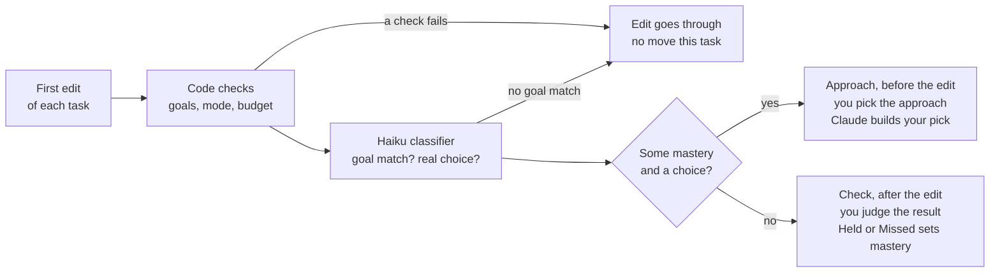

# Fathom: Executive Summary

November 23, 2026

Fathom is an open-source Claude Code plugin that keeps people learning while an agent does the work. A few times a day, at a real decision point in a real task, it hands you a choice or a check tied to a learning goal you set, then tells you how your answer held up. It is built for anyone who works through an agent and wants to keep getting better at the job, starting with software engineers.

## The problem

Agents now do most of the execution in technical work, and the people directing them learn less from it. Skill used to come from the struggle of doing the work: forming a hypothesis, choosing a design, chasing down a bug. Agents skip that struggle by default.

Controlled studies show what that costs. In a randomized trial with high school math students ([Bastani et al., 2025](https://econpapers.repec.org/RePEc:nas:journl:v:122:y:2025:p:e2422633122)), unrestricted GPT-4 raised practice grades 48% and cut grades on exams taken without it 17% against a control group. In a randomized trial of 52 developers learning a new Python library ([Shen and Tamkin, 2026](https://www.anthropic.com/research/AI-assistance-coding-skills)), the AI group averaged 50% on a comprehension quiz against 67% for those who coded by hand, and the widest gap was in debugging.

The same studies show that how people use AI decides the outcome. A tutor version of GPT-4 that gave hints rather than answers raised practice grades 127% and left exam grades about level with the control group. Developers who asked the AI conceptual questions averaged 65% on the quiz, and those who handed it the work averaged under 40%.

Nothing in today's agent tooling pushes people toward the first habit while they work. Early-career staff and people new to a codebase carry the most risk, because they are being asked to supervise work they never learned to do.

## The solution

Fathom puts the struggle back at the one point in a task where it teaches the most and leaves the rest at full agent speed. You set a few learning goals in plain language, such as "Diagnose failing pods in our staging cluster from events, logs and resource limits." When Claude's work touches one of them, Fathom hands you a single piece of the task in one of two forms, called moves:

- **Approach, before the edit.** If the task has a real design choice and you have shown some mastery of the goal, Claude stops before its first edit, lays out two or three approaches, and builds the one you pick.
- **Check, after the edit.** Otherwise Claude finishes the work, then asks one question about whether the change does what was needed. Your answer is judged Held or Missed, and that updates your mastery of the goal.

Each move is one click with a skip option. Fathom asks at most once per prompt and three times a day by default, and ship mode turns it off when you are on a deadline.

## How it works

Fathom decides once per task, at the first file edit.

Three Claude Code hooks do the work. A hook on file edits runs the code checks and the classifier, a hook at the end of Claude's turn asks the Check question, and a third records the answer. The classifier is Claude Haiku, called once per task through the person's own `claude` CLI. In a November 2026 test it took 3.8 to 5.7 seconds and about $0.0008 per call.

Any error lets the edit through, so Fathom never blocks work. A bundled output style, Partner, tells Claude how to ask: options specific to the change, no hint of its own preference, and no comment when the person skips. The classifier sends goals, session prompts and the pending edit to the model provider the session already uses, and Fathom stores none of it.

## Why this approach

- **In the work, not beside it.** Courses sit outside the job, and little of them transfers. Fathom's first prototype added learning instructions at session start, and people skipped the off-task questions it produced. A decision the task needs anyway is much harder to skip.
- **Goals decide when.** Claude Code's built-in Learning and Explanatory output styles change how Claude talks for a whole session, and busy people turn them off. Fathom acts task by task, only where the work touches a goal, and tracks mastery across sessions.
- **It shifts as skill grows.** Novices learn more from judging finished work, and people with some mastery learn more from making the call themselves. Fathom starts each goal on Check and moves it to Approach as mastery rises.
- **Private by default.** All data stays in `~/.fathom` on the person's machine, the core sends no telemetry, and the event log never holds prompts, code or question text. Learning data is never shared with managers or used to evaluate performance. People only risk being wrong when nobody is watching.

## Status and next steps

Fathom 0.0.4 is open source under MIT at [github.com/ChristianASC5/fathom](https://github.com/ChristianASC5/fathom). Both moves and the goals skill work end to end in real Claude Code sessions, and it installs as a plugin (`claude plugin install fathom --marketplace ChristianASC5/fathom`) or through APM.

1. **Usability round, 2 weeks, 8 to 10 target users.** It passes if most people keep Fathom on and call the moves relevant, and per-move skip rates show which moves earn their place.
2. **Controlled pilot, 6 to 8 weeks, randomized against a control group.** It passes if at least half the users are still active at week 4, score better than control on delayed tasks done without AI, and keep throughput within a tolerable margin.
3. **More moves, if the pilot holds.** Candidates are predict-then-run before tests, explain-back at PR time, and debug-first on failures.

Usage counts are not evidence of learning. The outcome that matters is unassisted skill, such as debugging an unfamiliar failure without AI two weeks after the related work.

## Sources

1. Hamsa Bastani, Osbert Bastani, Alp Sungu, Haosen Ge, Özge Kabakcı and Rei Mariman, ["Generative AI without guardrails can harm learning: Evidence from high school mathematics"](https://econpapers.repec.org/RePEc:nas:journl:v:122:y:2025:p:e2422633122), *PNAS* 122 (26), e2422633122, 2025. [doi:10.1073/pnas.2422633122](https://doi.org/10.1073/pnas.2422633122)
2. Judy Hanwen Shen and Alex Tamkin, ["How AI Impacts Skill Formation"](https://arxiv.org/abs/2601.20245), arXiv:2601.20245, January 2026. Anthropic's summary: ["How AI assistance impacts the formation of coding skills"](https://www.anthropic.com/research/AI-assistance-coding-skills), 29 January 2026.
3. Classifier latency and cost: Fathom's own headless test of the Haiku classifier on Claude Code 2.1.325, 16 November 2026.
